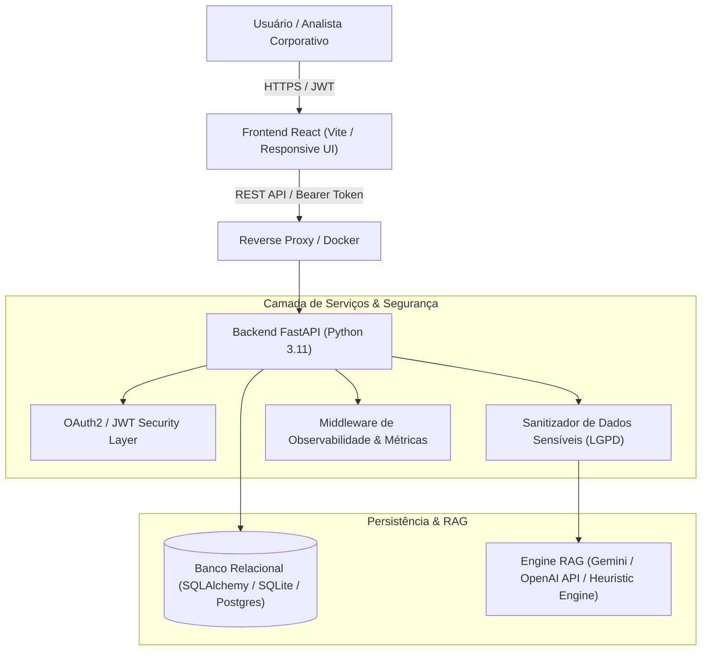

# Corporate AI & Document Management Platform (Full Stack Senior)
### Sistema FIEC — SESI GETIC | Inovação, Arquitetura Corporativa & IA Generativa

[](https://fastapi.tiangolo.com)
[](https://reactjs.org)
[](https://docker.com)
[](#segurança-e-lgpd)
[](#testes-automatizados)
[](https://joanasampaio07.github.io/corporate-ai-platform/)

---

> 🌐 **Acesse a Aplicação Online (Live Demo):**  
> 👉 **[https://joanasampaio07.github.io/corporate-ai-platform/](https://joanasampaio07.github.io/corporate-ai-platform/)**

---

## 🏛️ Visão Geral

Plataforma corporativa desenvolvida para gestão inteligente de documentos normativos, editais e contratos, integrando **Inteligência Artificial Generativa** com padrão de engenharia **Full Stack Sênior**.

O sistema implementa **RAG (Retrieval-Augmented Generation)** com sanitização prévia de dados pessoais sensíveis, garantindo estrita aderência à **LGPD**, controle de consumo de tokens e observabilidade ponta a ponta.

---

## 🏗️ Arquitetura do Sistema



---

## 🚀 Principais Funcionalidades

1. **Gestão de Documentos Corporativos:**
   - Ingestão, categorização por departamentos (TI, Inovação, RH, Financeiro) e níveis de confidencialidade (Interno, Público, Confidencial).
   - Validação estrita de contratos de dados utilizando **Pydantic v2**.
2. **Inteligência Artificial Generativa & RAG:**
   - Extração automática de resumos executivos e geração de tags semânticas na criação de documentos.
   - Assistente virtual integrado que responde a dúvidas citando fontes documentais auditáveis.
3. **Segurança da Informação & LGPD:**
   - Criptografia com PBKDF2/SHA-256 e autenticação Stateless via JWT.
   - Algoritmo de mascaramento automático de CPFs, telefones e identificadores pessoais antes de qualquer envio a provedores externos de IA.
4. **DevOps & Observabilidade:**
   - Headers de rastreamento (`X-Process-Time`) para auditoria de latência em milissegundos.
   - Empacotamento multietapas via Docker Compose.

---

## 🛠️ Como Executar o Projeto

### Opção 1: Execução com Docker (Recomendada)
Com o Docker instalado, execute na raiz do repositório:

```bash
docker compose up --build
```

* **Frontend:** [http://localhost:3000](http://localhost:3000)
* **Backend API:** [http://localhost:8000](http://localhost:8000)
* **Documentação Interativa (Swagger/OpenAPI):** [http://localhost:8000/docs](http://localhost:8000/docs)

---

### Opção 2: Execução Local (Sem Docker)

#### 1. Backend (Python):
```bash
cd backend
python -m venv venv
# Windows:
.\venv\Scripts\activate
# Linux/Mac:
source venv/bin/activate

pip install -r requirements.txt
uvicorn app.main:app --reload --port 8000
```

#### 2. Frontend (Node / React):
```bash
cd frontend
npm install
npm run dev
```
Acesse [http://localhost:3000](http://localhost:3000) no seu navegador.

---

## 🧪 Testes Automatizados

O backend conta com suíte de testes automatizados com `pytest` cobrindo fluxos de autenticação, criação de documentos e inferência RAG:

```bash
cd backend
pytest -v
```

---

## 🌐 Deploy no GitHub Pages

O frontend possui um **GitHub Action** configurado em `.github/workflows/deploy-pages.yml` e arquitetura híbrida (com modo standalone com persistência local). Ao fazer push para a branch `main`:
1. O GitHub Pages realiza o build e publica a aplicação automaticamente.
2. Qualquer recrutador ou avaliador pode testar a interface completa diretamente pela web, sem necessidade de servidores externos!

---

**Desenvolvido por:** Joana Paula Cardoso Sampaio  
**Perfil:** Desenvolvedora Full Stack Sênior  
**Candidatura:** Processo Seletivo SESI GETIC (FIEC) — Cód. 7758

